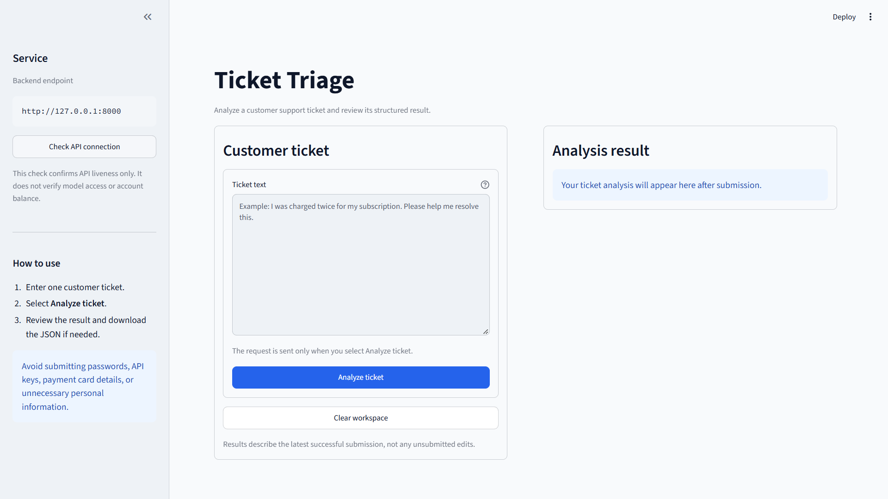

# AI-Powered Ticket Triage

An LLM-powered application for classifying and summarizing customer support tickets, built with FastAPI and Streamlit.

## Screenshot



## Features

- Ticket category, priority, and sentiment classification.
- Concise summaries and optional intent detection.
- Structured output validation with Pydantic.
- FastAPI endpoints for single-ticket processing and health checks.
- Streamlit interface with input validation and error handling.
- Offline CSV batch-processing and evaluation utilities.
- API and UI tests using fake engines and mocked HTTP requests.

## Architecture

```text
Streamlit UI → FastAPI → Ticket Pipeline → LLM Provider
```

The UI communicates with the backend over HTTP. Model credentials stay in the backend, and FastAPI dependencies provide the pipeline to endpoints.

## Setup

Run commands from the project root.

### 1. Create and activate a virtual environment

```bash
python -m venv venv
```

Windows PowerShell:

```powershell
.\venv\Scripts\Activate.ps1
```

macOS / Linux:

```bash
source venv/bin/activate
```

### 2. Install dependencies

```bash
python -m pip install -r requirements.txt
python -m pip install -r requirements-dev.txt
```

### 3. Configure the model

Create a `.env` file in the project root:

```dotenv
OPENAI_API_KEY=your_api_key_here
OPENAI_MODEL_NAME=gpt-4o-mini
```

For an alternative OpenAI-compatible provider, also set:

```dotenv
OPENAI_BASE_URL=https://your-provider.example/v1
```

Use a model supported by your provider. Live requests require valid credentials and sufficient quota.

**Do not commit `.env` or API keys.**

### 4. Start the backend

```bash
python -m uvicorn src.api.main:app --reload
```

- API: http://127.0.0.1:8000
- API documentation: http://127.0.0.1:8000/docs

### 5. Start the interface

In another terminal, activate the virtual environment and run:

```bash
python -m streamlit run ui/app.py
```

Open the URL displayed by Streamlit.

## UI Configuration

| Environment variable | Default |
|---|---|
| `TICKET_API_BASE_URL` | `http://127.0.0.1:8000` |
| `TICKET_UI_TIMEOUT_SECONDS` | `90` |
| `TICKET_UI_HEALTH_TIMEOUT_SECONDS` | `3` |

Set these in the environment before starting Streamlit. The UI settings loader does not load `.env` itself.

## API

### `GET /health`

Checks backend liveness without calling the model or checking account quota.

```json
{
  "status": "ok"
}
```

### `POST /triage`

Request:

```json
{
  "ticket_text": "I was charged twice for my subscription. Please help."
}
```

Example response:

```json
{
  "category": "payment",
  "priority": "medium",
  "sentiment": "negative",
  "intent": null,
  "summary": "Customer reports a duplicate subscription charge."
}
```

This response is illustrative. Actual predictions and wording depend on the input and model.

## UI Behavior

- Analysis starts only when **Analyze ticket** is selected.
- Ticket input is limited to 12,000 characters.
- Previous results are cleared before a new submission.
- Failed requests display an error instead of a stale result.
- Requests are not automatically retried by the UI.
- A client timeout does not necessarily stop backend processing.

## Tests

```bash
python -m pytest tests/test_api.py tests/test_ui_client.py tests/test_ui_app.py -q
```

Tests use fake engines and mocked HTTP requests, avoiding paid model calls. They validate application behavior, not model prediction quality.

## Batch Processing and Evaluation

Offline utilities process CSV data with pandas.

For the project dataset, `instruction` contains the customer message and `response` contains the support reply. Ticket processing uses `instruction`.

Reference labels are available for category and intent, but not sentiment or priority. Evaluation should report missing predictions separately from incorrect predictions.

Batch processing is not exposed through the API.

## Limitations and Security

- Model predictions may be incorrect and require human review.
- Schema validation checks output structure, not factual correctness.
- Live processing depends on provider availability and quota.
- Authentication and usage limits are required before public deployment.
- Keep credentials in the backend and avoid logging sensitive ticket data.
- Deploy the backend separately and configure the UI with its reachable URL; `127.0.0.1` does not point to your computer from a hosted service.

This project is intended for local development and portfolio demonstration, not production use.
